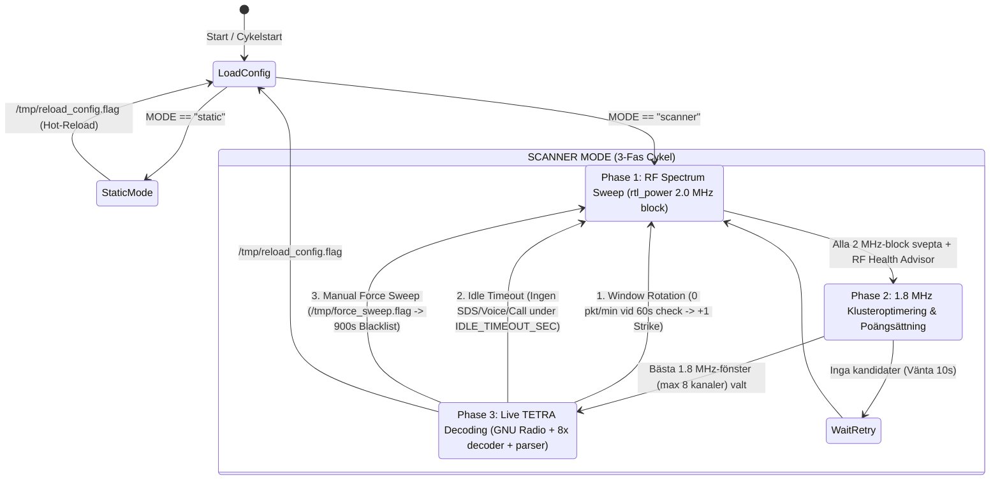

# System- och Flödesanalys: `tetra_scanner` (CalVer `2026.11.05.01`)

Detta dokument utgör den tekniska arkitekturdokumentationen för **`tetra_scanner`** – en flerkanalig realtidsmottagare, protokollavkodare och spektrumanalysator för TETRA-nätverk (ETSI EN 300 392-2), primärt optimerad för tåg-, kollektivtrafik- och kritisk infrastrukturkommunikation (exempelvis MCC `240` / MNC `11`).

---

## 1. Övergripande Arkitektur

Systemet är konstruerat enligt en modulär, händelsedriven flerprocessarkitektur i en isolerad Linux-container (`Ubuntu 20.04`). Genom att separera **RF-demodulering** (C++/GNU Radio), **Lager-2/MAC-dekodning** (C++ `tetra-kit`), **Applikations- och protokolltolkning** (Python), **Orkestrering/State Management** (Python) samt **WebUI/API-exponering** (FastAPI + SQLite WAL) undviks flaskhalsar (såsom Python GIL) i de tidskritiska signalbehandlingsleden.

### Huvudkomponenter och Ansvarsområden

| Komponent | Filväg | Språk / Ramverk | Ansvarsområde |
| :--- | :--- | :--- | :--- |
| **Entrypoint & Bootstrap** | [`entrypoint.sh`](file:///d:/antigravity/tetra_scanner/entrypoint.sh) | Bash | Validerar miljövariabler (`.env`) via SHA-256-kontrollsumma (`.env_checksum`), rensar gamla styrflaggor i `/tmp`, startar `uvicorn` (`web_api.py`) som bakgrundsprocess och lämnar över PID 1-exekveringen till `scanner_orchestrator.py`. |
| **Scanner Orchestrator** | [`src/scanner_orchestrator.py`](file:///d:/antigravity/tetra_scanner/src/scanner_orchestrator.py) | Python 3 | Systemets tillståndsmaskin och processledare. Styr `SCANNER`- och `STATIC`-läge, exekverar **Phase 1** (`rtl_power` spektrumsvep + RF Health & Gain Advisor), **Phase 2** (1.8 MHz klusteroptimering med viktad poängsättning, Whitelist-boost och Strike-nedviktning) samt **Phase 3** (start och övervakning av underprocesser, `60s` heartbeat-utvärdering, Idle Timeout och fönsterrotation). |
| **Multi-Channel RF Receiver** | [`src/tetra_multi_rtl.py`](file:///d:/antigravity/tetra_scanner/src/tetra_multi_rtl.py) | Python 3 / GNU Radio (`gr-osmosdr`) | Kopplar upp mot RTL-SDR med `2.0 MS/s` bandbredd kring `CENTER_FREQ`. Instansierar upp till **8 parallella `tetra_chan`-kanalblock** som samtidigt filtrerar, frekvensskiftar, omsamplar (`36 kS/s`) och demodulerar $\pi/4$-DQPSK till råa symbolbitar över lokala UDP-portar (`42001`–`42008`). |
| **Lower/Upper MAC C++ Decoder** | `/opt/tetra-kit/decoder/decoder` | C++ (`tetra-kit`) | En separat C++-process per aktiv kanal (upp till 8 parallella instanser). Tar emot demodulerade symbolbitar på UDP `42000 + idx`, utför burst-synkronisering, de-interleaving, RCPC Viterbi-avkodning, Reed-Muller (AACH), `CRC-16`-validering (`0x1D0F`), LLC/MAC-defragmentering (`MAC-RESOURCE` + `MAC-FRAG` + `MAC-END`) och emitterar strukturerade JSON-paket på UDP `42100 + idx`. |
| **TETRA Protocol & Voice Parser** | [`src/tetra_parser.py`](file:///d:/antigravity/tetra_scanner/src/tetra_parser.py) | Python 3 / ETSI Codec (`cdecoder`, `sdecoder`) | Lyssnar icke-blockerande (`select.select`) på UDP `42101`–`42108`. Filtrerar bort icke-verifierat `TCH_S`-brus, bygger upp nätverkstopologi (`SYSINFO`/`D-NWRK-BROADCAST`), avkodar `D-SDS-DATA` (`SDS-TL`, GSM 7-bit, ISO-8859-1, UTF-16BE, LIP GPS, NMEA, Triona, TrainRouteSync, AVL), aggregerar och validerar röstsamtal (`TCH_S` -> `cdecoder` BFI-kontroll -> `sdecoder` PCM -> `.wav`), uppdaterar `whitelist.json` samt skriver till JSONL, SQLite, MQTT och extern UDP. |
| **Persistent Database Engine** | [`src/db.py`](file:///d:/antigravity/tetra_scanner/src/db.py) | Python 3 / SQLite 3 (`WAL`) | Trådsäker relationsdatabas (`/app/logs/tetra_scanner.db`) i `Write-Ahead Logging` (`WAL`)-läge. Hanterar tabellerna `events`, `channel_hourly_stats`, `units` och `rf_sweeps`, inklusive en minnesbuffrad 5-sekunders batchskrivare för högfrekventa råpaket och automatisk migrering (backfill) från `tetra_events.jsonl`. |
| **Web API & Real-Time Stream** | [`src/web_api.py`](file:///d:/antigravity/tetra_scanner/src/web_api.py) | Python 3 / FastAPI / Uvicorn | Exponerar REST-endpoints för konfiguration (`/api/config` med hot-reload), historiksökning (`/api/history`), spektrum- och enhetsanalys (`/api/analytics`), nätverkstopologi (`/api/networks`), vit-/svartlistehantering (`/api/whitelist`, `/api/blacklist`), ljuduppspelning (`/api/audio/*.wav`) samt en asynkron WebSocket-ström (`/ws/events`) som tailar `tetra_events.jsonl` i realtid. |
| **Frontend Dashboard** | [`src/templates/index.html`](file:///d:/antigravity/tetra_scanner/src/templates/index.html) | HTML5 / TailwindCSS / Vanilla JS | Single-Page Dashboard med tre huvudvyer (**Live Stream**, **History Archive (SQLite)** och **Frequency & Unit Analytics**), kontrollpaneler för **Discovered Networks**, **Whitelisted Frequencies** (`Lock Static`), **Blacklisted Frequencies** samt **Settings** med inbyggd RF Gain & Signal Advisor. |

---

## 2. End-to-End Dataflöde

Nedanstående Mermaid-diagram illustrerar hur radiosignalen färdas från antennen genom hårdvaran, C++/GNU Radio-pipelinen, Python-parsern, lagringslagret och hela vägen ut till användarens webbläsare och Home Assistant.

```mermaid
flowchart TD
    subgraph RF_Layer["1. RF & SDR Inmatning"]
        ANT["UHF Antenn (420-430 MHz)"] --> RTLSDR["RTL-SDR USB Dongle (2.0 MS/s IQ)"]
    end

    subgraph Orchestration["2. Process- & Skannerorkestrering (scanner_orchestrator.py)"]
        ORCH["scanner_orchestrator.py"]
        RTLPOW["Phase 1: rtl_power (25 kHz rutnät)"]
        P2["Phase 2: 1.8 MHz Klusterväljare (Max 8 kanaler)"]
        ORCH -->|Kör svep i Scanner-läge| RTLPOW
        RTLPOW -->|CSV dBm & Brusgolv| P2
        P2 -->|CENTER_FREQ + TETRA_CHANNELS| ORCH
    end

    subgraph Demod_Layer["3. Parallell Demodulering & MAC-Avkodning (Phase 3)"]
        GR["tetra_multi_rtl.py (GNU Radio Top Block)"]
        CH1["tetra_chan #1..#8 (FIR Xlating -> AGC -> FLL -> PFB -> pi/4-DQPSK)"]
        DEC["8x tetra-kit C++ decoder (Viterbi, Reed-Muller, CRC-16, LLC Defrag)"]
        WAVCOD["ETSI Codec (cdecoder + sdecoder)"]

        RTLSDR -->|2.0 MS/s IQ-ström| GR
        ORCH -->|Startar & övervakar| GR
        ORCH -->|Startar 8 instanser| DEC
        GR --> CH1
        CH1 -->|Symbolbitar UDP 127.0.0.1:42001..42008| DEC
    end

    subgraph Parser_Layer["4. Protokollanalys & Validering (tetra_parser.py)"]
        PARSER["tetra_parser.py (Icke-blockerande UDP-select)"]
        CRC_FILTER["CRC-16 Kontrollverifiering & TCH_S Spökfilter"]
        NET_DISC["Nätverksupptäckt (SYSINFO / D-NWRK-BROADCAST)"]
        SDS_DEC["SDS & Telemetri-avkodare (SDS-TL, GSM-7, Latin-1, UCS-2, LIP GPS, Triona)"]
        VOICE_BUF["Voice Buffer & BFI/Amplitud-validering"]

        DEC -->|Rå JSON UDP 127.0.0.1:42101..42108| PARSER
        PARSER --> CRC_FILTER
        CRC_FILTER -->|SYSINFO / SYNC| NET_DISC
        CRC_FILTER -->|D-SDS-DATA| SDS_DEC
        CRC_FILTER -->|TCH_S (Verifierad kanal)| VOICE_BUF
        VOICE_BUF <-->|Subprocess .out -> .cod -> .raw| WAVCOD
        PARSER -->|Stdout: Payload-loggar & 60s Heartbeat| ORCH
    end

    subgraph Storage_Layer["5. Persistens & Externa Integrationer (/app/logs)"]
        JSONL["tetra_events.jsonl & discovered_networks.jsonl"]
        WL_BL["whitelist.json & blacklist.json"]
        SQLITE[("SQLite WAL DB (tetra_scanner.db)")]
        WAV_FS["/app/logs/audio/voice_*.wav"]
        MQTT["MQTT Broker (Home Assistant Auto-Discovery)"]

        NET_DISC --> JSONL
        NET_DISC --> WL_BL
        SDS_DEC --> JSONL
        SDS_DEC --> SQLITE
        VOICE_BUF --> WAV_FS
        VOICE_BUF --> JSONL
        VOICE_BUF --> SQLITE
        PARSER --> MQTT
        P2 <-->|Läser/uppdaterar| WL_BL
        RTLPOW -->|Sparar RF-toppar| SQLITE
    end

    subgraph Presentation_Layer["6. Web API & Frontend (web_api.py + index.html)"]
        FASTAPI["FastAPI (web_api.py)"]
        WS["WebSocket (/ws/events)"]
        REST["REST API (/api/history, /api/analytics, /api/config, /api/networks)"]
        UI["WebUI Dashboard (Live Stream, History Archive, Analytics, Settings)"]

        JSONL -->|Asynkron fil-tailing (0.25s)| WS
        SQLITE <-->|Indexerade SQL-frågor| REST
        WAV_FS -->|StaticFiles /api/audio| FASTAPI
        WL_BL <--> REST
        REST -->|Flagga: /tmp/reload_config.flag| ORCH
        WS --> UI
        REST <--> UI
    end
```

### Steg-för-steg genomgång av dataflödet

1. **RF-fångst och Kanalisering ([`src/tetra_multi_rtl.py`](file:///d:/antigravity/tetra_scanner/src/tetra_multi_rtl.py)):**
   - `osmosdr.source` öppnar RTL-SDR-mottagaren med samplingshastigheten `2 000 000 S/s` (`2.0 MHz` bandbredd), fast förstärkning (`RTL_GAIN`, med automatisk förstärkning avstängd via `set_gain_mode(False, 0)`) och frekvenskorrigering (`RTL_PPM`).
   - För varje kanal `idx` (`1..8`) i miljövariabeln `TETRA_CHANNELS` (format `frekvens_hz:la`) skapas ett hierarkiskt GNU Radio-block [`tetra_chan`](file:///d:/antigravity/tetra_scanner/src/tetra_multi_rtl.py#L17-L78):
     1. **`freq_xlating_fir_filter_ccc`**: Skiftar kanalens frekvens (`freq_hz - center_freq`) till basbandet med ett Hamming-lågpassfilter (`18 kHz` passband, `5 kHz` övergångsband) och decimerar med faktor `32` (`2 000 000 / 32 = 62 500 S/s`).
     2. **`mmse_resampler_cc`**: Omsamplar exakt till `36 000 S/s` (`2` samples per symbol vid TETRA:s symbolhastighet `18 000 baud`).
     3. **`feedforward_agc_cc` + `fll_band_edge_cc`**: Automatisk nivåreglering (16 samples fönster) följt av en Frequency Lock Loop (roll-off `0.35`) som låser på bärvågen även vid mindre frekvensavvikelser.
     4. **`pfb_clock_sync_ccf`**: Polyphase Filterbank-klocksynkronisering med ett Root-Raised-Cosine-filter (`RRC`, $\alpha = 0.35$, 32 filtergrenar) som reducerar samplingshastigheten från `2 sps` till `1 sps` (`18 000` komplexa symboler/sekund).
     5. **`diff_phasor_cc` + `constellation_decoder_cb` + `unpack_k_bits_bb(2)`**: Differentiell fasavkodning ($\pi/4$-DQPSK) av de fyra konstellationspunkterna ($\pm \pi/4, \pm 3\pi/4$) till 2 bitar per symbol (`36 000 bit/s`), vilka skickas i paket om 1472 bytes över UDP till `127.0.0.1:(42000 + idx)`.

2. **MAC- och FEC-avkodning (`tetra-kit/decoder`):**
   - För varje kanal `idx` körs en dedikerad C++-process: `/opt/tetra-kit/decoder/decoder -r 4200X -t 4210X`.
   - Den söker efter TETRA:s träningssekvenser (`Sync Training Sequence` samt `Normal Training Sequence 1/2`), avkodar Access Assignment Channel (`AACH` med Reed-Muller-kod), avskramlar bitarna med cellens färg-/nätverkskod, kör Viterbi-felrättande avkodning (RCPC) och kontrollerar 16-bitars `CRC-CCITT` (`0x1D0F`) på alla kontroll- och signaleringsblock (`SB1`, `SB2`, `NDB`, `SCH_F`, `SCH_HU`).
   - Vid fragmenterade flerslotsmeddelanden (`MAC-RESOURCE` följt av `MAC-FRAG` och `MAC-END`) återmonterar `tetra-kit` bitströmmen och skickar färdiga JSON-rader via UDP till `127.0.0.1:(42100 + idx)`.

3. **Python-parserns mottagning och förädling ([`src/tetra_parser.py`](file:///d:/antigravity/tetra_scanner/src/tetra_parser.py)):**
   - Huvudloopen i [`main()`](file:///d:/antigravity/tetra_scanner/src/tetra_parser.py#L1086-L2789) använder `select.select(rx_sockets, [], [], 0.5)` för att lyssna parallellt på samtliga 8 UDP-portar (`42101`–`42108`) i en enda tråd utan busy-wait.
   - Varje inkommande JSON-rad skickas till [`process_packet(ch, pkt)`](file:///d:/antigravity/tetra_scanner/src/tetra_parser.py#L2386-L2700), som kategoriserar trafiken i `NETWORK`, `SDS`, `CALL`, `VOICE`, `STATUS`, `ROAMING` eller `RAW_MAC`.
   - Förädlade händelser skrivs via [`emit_event()`](file:///d:/antigravity/tetra_scanner/src/tetra_parser.py#L1394-L1430) samtidigt till:
     - `/app/logs/tetra_events.jsonl` (realtidslogg för WebSocket).
     - `/app/logs/tetra_scanner.db` via [`db.record_event()`](file:///d:/antigravity/tetra_scanner/src/db.py#L465-L476) (strukturerad SQLite-databas).
     - `stdout` (läses i realtid av `scanner_orchestrator.py` för aktivitetsdetektering).
     - MQTT-brokern (`tetra/240_11/event` samt kategorispecifika topics med Home Assistant Auto-Discovery).

4. **Exponering mot WebUI ([`src/web_api.py`](file:///d:/antigravity/tetra_scanner/src/web_api.py) & [`src/templates/index.html`](file:///d:/antigravity/tetra_scanner/src/templates/index.html)):**
   - **Realtidsström (`/ws/events`):** När en webbläsare ansluter läser [`read_recent_lines()`](file:///d:/antigravity/tetra_scanner/src/web_api.py#L689-L718) in de senaste 100 meningsfulla payload-händelserna och de senaste 25 `[SYSTEM]`-meddelandena (samtidigt som `RAW_MAC` filtreras bort vid initial laddning så att tidigare samtal/SDS inte dränks). Därefter pollar WebSocket-loopen filstorleken på `tetra_events.jsonl` var `0.25` sekund och pushar nya rader direkt till klienten.
   - **Historik & Analys (`/api/history`, `/api/analytics`):** Exekveras i FastAPI:s bakgrundstrådpool mot SQLite WAL-databasen, vilket ger omedelbar filtrering på frekvens, `SSI`, tåglinje, fritext och tidsfönster utan att behöva skanna igenom tiotals megabyte textloggar.

---

## 3. Skanningslogik & State Management (`scanner_orchestrator.py`)

[`src/scanner_orchestrator.py`](file:///d:/antigravity/tetra_scanner/src/scanner_orchestrator.py) fungerar som en överordnad tillståndsmaskin som antingen kör i **`STATIC`-läge** (låst till en fast centerfrekvens och kanallista) eller i **`SCANNER`-läge** (automatisk 3-fasig spektrumspaning och kanalvalidering).



### Phase 1: RF Spectrum Sweep (`phase1_sweep_band` & `parse_block_csv`)

1. **Uppdelning i 2.0 MHz-block ([`build_center_frequencies`](file:///d:/antigravity/tetra_scanner/src/scanner_orchestrator.py#L358-L366)):**
   - Bandet mellan `SCAN_START_MHZ` och `SCAN_END_MHZ` (t.ex. `426.0`–`430.0 MHz`) delas upp i sammanhängande `2.0 MHz`-block med centerfrekvenser på `start + 1.0 MHz`, `start + 3.0 MHz`, osv. (exempelvis `427.0 MHz` för `426–428 MHz` och `429.0 MHz` för `428–430 MHz`).
2. **Spektrummätning ([`run_rtl_power_sweep`](file:///d:/antigravity/tetra_scanner/src/scanner_orchestrator.py#L369-L419)):**
   - För varje block körs `rtl_power -d <idx> -f start_hz:end_hz:2k -g <gain> -p <ppm> -i 10 -1 /tmp/scan_<center>.csv` under 10 sekunder med `2 kHz` FFT-upplösning.
3. **Brusgolv, Skyddsband och 25 kHz PTS-Kvantisering ([`parse_block_csv`](file:///d:/antigravity/tetra_scanner/src/scanner_orchestrator.py#L444-L585)):**
   - **Skyddsband:** För att eliminera RTL-SDR-specifika hårdvaruartefakter förkastas alla FFT-bins inom `±10 kHz` från blockets centerfrekvens (`DC_SPIKE_GUARD_HZ = 10000`) samt `15 kHz` från blockets ytterkanter (`EDGE_GUARD_HZ = 15000`).
   - **Dynamiskt brusgolv:** Brusgolvet (`noise_floor`) beräknas som **medianen** (`statistics.median`) av samtliga uppmätta frekvensbins i 2 MHz-blocket. Medianen påverkas inte av hur många starka TETRA-bärvågor som finns i blocket.
   - **Tröskelvärde:** En signal måste överstiga `min_threshold = max(noise_floor + 1.8 dB, -65.0 dBm)`.
   - **25 kHz Aggregering & Lokal Toppdetektering:** Eftersom en TETRA-bärvåg är `18 kHz` bred sträcker sig dess energi över 8–9 intilliggande `2 kHz`-bins. Alla FFT-bins kvantiseras därför först till PTS 25 kHz-kanalraster (`snapped_25k = round(freq_hz / 25000) * 25000`). Därefter behålls endast **lokala maxima** där energin i `snapped_25k` är strikt starkare än grannkanalerna `snapped_25k - 25 kHz` och `snapped_25k + 25 kHz`. Detta förhindrar att en bred TETRA-bärvåg eller en stark störsändare registreras som 3–4 separata "spökkanaler".
4. **Automatisk RF Health & Gain Advisor ([`phase1_sweep_band`](file:///d:/antigravity/tetra_scanner/src/scanner_orchestrator.py#L641-L699)):**
   - Utvärderar medianbrusgolvet mot det optimala arbetsområdet för RTL-SDR (`-44.0` till `-34.5 dBm`), varnar vid ADC-mättnad (`dbm >= -12.0 dBm` eller `noise_floor > -29.0 dBm`) och ger konkreta rekommendationer i dB om `RTL_GAIN` bör höjas eller sänks.

---

### Phase 2: 1.8 MHz Fönsteroptimering & Viktad Poängsättning (`phase2_select_best_window`)

En enskild RTL-SDR-mottagare som körs i `2.0 MS/s` kan demodulera valfritt antal kanaler parallellt så länge samtliga kanaler ryms inom ett sammanhängande fönster om **`1.8 MHz` (`MAX_WINDOW_SPAN_HZ = 1_800_000`)** och högst **`8` kanaler (`MAX_PEAKS = 8`)**.

1. **Sammanslagning av Kandidatkällor ([`phase2_select_best_window`](file:///d:/antigravity/tetra_scanner/src/scanner_orchestrator.py#L707-L847)):**
   Algoritmen kombinerar tre källor inom det konfigurerade sökbandet (`SCAN_START_MHZ`–`SCAN_END_MHZ`):
   - **Uppmätta RF-toppar (`MEASURED`):** Från Phase 1.
   - **Vitlistade basstationer (`WHITELIST` / `MEASURED+WHITELIST`):** Frekvenser i `/app/logs/whitelist.json` som tidigare har bekräftats skicka CRC-verifierad TETRA-trafik. Om en vitlistad kanal inte var en egen lokal topp i Phase 1 hämtas dess aktuella signalstyrka och SNR direkt ur `measured_grid`.
   - **Seed-kanaler (`SEED`):** Förkonfigurerade kanaler i `TETRA_CHANNELS`.
   - **Svartlistefiltrering:** Kanaler vars `expire_at > now_ts` i `blacklist.json` exkluderas helt under strafftiden. Kanaler som har varningar (`strikes > 0` men `expire_at == 0`) behålls men får en kraftig poängreduktion.

2. **Matematisk Poängmodell för Glidande 1.8 MHz-fönster ([rader 868–939](file:///d:/antigravity/tetra_scanner/src/scanner_orchestrator.py#L868-L939)):**
   För varje kandidatfrekvens $f_a$ prövas fönstret $[f_a, f_a + 1.8\text{ MHz}]$. Om fler än 8 kandidater ryms i fönstret väljs de 8 starkaste utifrån prioriteringsordningen: `(whitelisted, seed_channel, -strikes, snr_db, dbm)`.
   Varje kanal $p$ i fönstret tilldelas en viktad poäng enligt:

   $$\text{strike\_factor} = 0.12^{\text{strikes}}$$

   $$\text{dbm\_bonus} = \begin{cases} \max(0, (\text{dBm} + 45.0) \times 0.4) & \text{om } \text{SNR} \ge 3.0\text{ dB} \\ 0 & \text{annars} \end{cases}$$

   $$\text{score}(p) = \begin{cases} (25.0 + 2.5 \cdot \text{SNR} + \text{dbm\_bonus}) \times 0.12^{\text{strikes}} & \text{om Whitelisted} \\ (12.0 + 2.0 \cdot \text{SNR} + \text{dbm\_bonus}) \times 0.12^{\text{strikes}} & \text{om Seed-kanal} \\ (4.0 + 1.8 \cdot \text{SNR} + \text{dbm\_bonus}) \times 0.12^{\text{strikes}} & \text{om Ny RF-topp} \end{cases}$$

   - **Varför fungerar denna modell så bra?**
     - En verifierad **Whitelist-kanal** får en baspoäng på `25.0`, vilket gör att kända TETRA-basstationer alltid prioriteras över okända analoga bärvågor eller DMR-signaler (`4.0` baspoäng).
     - En obekräftad frekvens som vid en tidigare kontroll gav `0 pkt/min` får `1 strike`, vilket multiplicerar dess poäng med $0.12^1 = 0.12$ (en sänkning med **88 %**). Vid `2 strikes` multipliceras poängen med $0.12^2 = 0.0144$ (**98.5 %** reduktion), vilket tvingar fönsterväljaren att prova andra delar av bandet innan kanalen ens nått sin fulla svartlistning (`3 strikes`).
   - **Centerfrekvens och DC-offset-skydd ([rader 946–981](file:///d:/antigravity/tetra_scanner/src/scanner_orchestrator.py#L946-L981)):**
     Fönstrets centerfrekvens placeras mitt emellan den lägsta och högsta valda kanalen, avrundat till `25 kHz`. Om någon av de valda kanalerna hamnar närmare centerfrekvensen än `12.5 kHz` förskjuts `center_hz` med `+12.5 kHz` så att ingen TETRA-kanal någonsin krockar med RTL-SDR-mottagarens DC-spik vid `0 Hz` basband.

---

### Phase 3: Live Decoding, Heartbeat-validering & Kanalhopp (`phase3_monitor_channels`)

I [`phase3_monitor_channels`](file:///d:/antigravity/tetra_scanner/src/scanner_orchestrator.py#L1019-L1319) startar orkestratorn `N` stycken `tetra-kit/decoder`-processer, `1` `tetra_multi_rtl.py`-process och `1` `tetra_parser.py`-process, och läser parserns `stdout` via en trådsäker kö (`line_queue`).

Orkestratorn övervakar fyra villkor för tillståndsövergångar och kanalhopp:

1. **60-sekunders Heartbeat & Snabb Fönsterrotation (`[60s CHANNEL CHECK]`, [rader 1143–1225](file:///d:/antigravity/tetra_scanner/src/scanner_orchestrator.py#L1143-L1225)):**
   - Var 60:e sekund skriver `tetra_parser.py` ut `[heartbeat] ... per channel: {...}` med antalet mottagna CRC-verifierade paket per kanal under den senaste minuten.
   - **Aktiv kanal (`cnt > 0`):** Kanalen läggs till i `verified_tetra_hz` och eventuella tidigare varnings-strikes i `blacklist.json` nollställs omedelbart via [`clear_frequency_strikes()`](file:///d:/antigravity/tetra_scanner/src/scanner_orchestrator.py#L232-L244).
   - **Helt dött fönster (`not alive_in_hb and not verified_tetra_hz`):** Om **samtliga** kanaler i fönstret har `0 pkt/min` efter 60 sekunder (exempelvis om fönstret låste på icke-TETRA-bärvågor), väntar orkestratorn **inte** på hela `IDLE_TIMEOUT_SEC` (900s). Istället tilldelas kanalerna omedelbart `+1 strike` (`No TETRA sync (0 pkt/min)`) och orkestratorn bryter Phase 3 direkt (`[WINDOW ROTATION]`) för att rotera till nästa kandidatfönster!
   - **Isolerade tysta kanaler i ett i övrigt aktivt fönster (`isolated_dead`):** Om exempelvis 5 kanaler är äkta TETRA-basstationer och 2 kanaler i samma fönster var falska RF-toppar (`0 pkt/min`), får de 2 tysta kanalerna `+1 strike` så att de rensas bort vid nästa svep, medan mottagningen fortsätter ostört på de 5 aktiva basstationerna.

2. **Idle Timeout (`IDLE_TIMEOUT_SEC`, standard 900s, [rader 1286–1315](file:///d:/antigravity/tetra_scanner/src/scanner_orchestrator.py#L1286-L1315)):**
   - Timern `last_activity` nollställs endast när riktig nyttolast (`[SDS]`, `[CALL]`, `[VOICE]`, `[STATUS]`, `[ROAMING]`) dekodas.
   - Om `IDLE_TIMEOUT_SEC` löper ut i `SCANNER`-läge avbryts Phase 3 för ett nytt spektrumsvep, men:
     - Kanaler i `verified_tetra_hz` (som har sänt giltiga TETRA-kontrollramar under passet) **skyddas** (`Preserving verified TETRA base station(s)`).
     - Dessutom skyddar [`add_frequencies_to_blacklist()`](file:///d:/antigravity/tetra_scanner/src/scanner_orchestrator.py#L260-L264) alltid alla kanaler i `whitelist.json` från att svartlistas vid en vanlig Idle Timeout.

3. **Manual Force Sweep (`/tmp/force_sweep.flag`, [rader 1254–1270](file:///d:/antigravity/tetra_scanner/src/scanner_orchestrator.py#L1254-L1270)):**
   - När användaren klickar på **Force Sweep** i WebUI skapas `/tmp/force_sweep.flag`. Orkestratorn svartlistar då nuvarande kanaler tillfälligt i `900s` (`immediate=True`) och tvingar fram ett nytt Phase 1-svep för att utforska andra frekvenser.

4. **Hot-Reload av Konfiguration (`/tmp/soft_config.flag` vs `/tmp/reload_config.flag`):**
   - **Mjuk omladdning (`SOFT_CONFIG_FLAG`):** Om användaren bara ändrar `IDLE_TIMEOUT_SEC` eller `BLACKLIST_STRIKES` läser orkestratorn in nya värden i minnet utan att starta om GNU Radio eller avbryta pågående samtal.
   - **Hård omladdning (`RELOAD_CONFIG_FLAG`):** Om `MODE`, `RTL_GAIN`, `RTL_PPM`, `CENTER_FREQ` eller `TETRA_CHANNELS` ändras avslutas underprocesserna rent via [`terminate_children()`](file:///d:/antigravity/tetra_scanner/src/scanner_orchestrator.py#L311-L341) och pipelinen startar om med de nya RF-parametrarna inom ~1.5 sekunder.

---

## 4. TETRA-Specifik Protokollogik (`tetra_parser.py`)

### 4.1 Brusfiltrering, CRC-16-validering och Spök-`TCH_S`-skydd

En kritisk utmaning i TETRA-mottagare som bygger på `tetra-kit` är skillnaden mellan **kontrollkanalsblock (C-plane)** och **trafikkanalsblock för tal (U-plane / `TCH_S`)**:
- Alla C-plane-block (`SB1`, `SB2`, `NDB`, `SCH_F`, `SCH_HU`) som bär `SYNC`, `SYSINFO`, `D-NWRK-BROADCAST`, `ACCESS-ASSIGN`, `MAC-RESOURCE`, `D-SDS-DATA` och `D-SETUP` skyddas av en **16-bitars CRC-CCITT (`0x1D0F`)** i lower MAC. Ett C-plane-paket kan därför inte skapas av slumpmässigt brus.
- Talbursts (`TCH_S`, `service: "UPLANE"`) saknar däremot `CRC-16` i MAC-lagret eftersom ACELP-talkodaren är designad för att tolerera bitfel i luften. Om en annan digital sändare (t.ex. DMR/POCSAG/telemetri) eller kraftigt RF-brus råkar korrelera med den 22-bitars träningssekvensen och AACH Reed-Muller-headern ger en `usage_marker >= 4`, genererar `tetra-kit` enstaka falska `TCH_S`-paket med `ssi: 0`.

För att eliminera falska paket och spökljud implementerar [`src/tetra_parser.py`](file:///d:/antigravity/tetra_scanner/src/tetra_parser.py) ett **trestegsfilter**:

1. **Krav på C-plane CRC-synk per kanal (`control_verified`, [rader 1663–1705](file:///d:/antigravity/tetra_scanner/src/tetra_parser.py#L1663-L1705) & [2386–2418](file:///d:/antigravity/tetra_scanner/src/tetra_parser.py#L2386-L2418)):**
   - En frekvens får flaggan `state["control_verified"] = True` **endast** när den har tagit emot minst ett CRC-16-verifierat C-plane-paket (`not is_uplane`) eller laddats in från en tidigare C-plane-verifierad post i `discovered_networks.jsonl`.
   - Om ett `TCH_S`/`UPLANE`-paket anländer med `ssi in (None, 0, 16777215)` på en kanal där `control_verified == False`, förkastas paketet **innan** `stats_60s`, `db.record_raw_packet_stat` eller `observe_channel_activity` anropas. Därmed visar icke-TETRA-kanaler `0 pkt/min` och kan aldrig vitlistas av misstag.
2. **Kontext- och Dummy-SSI-filtrering ([rader 2420–2485](file:///d:/antigravity/tetra_scanner/src/tetra_parser.py#L2420-L2485)):**
   - `TCH_S`-ramar med broadcast-dummy `SSI = 16777215` (`0xFFFFFF`) eller utan vare sig giltig `SSI`, `GSSI` eller `usage_marker > 0` förkastas.
   - Korta brusfragment under `MIN_VOICE_FRAMES` (`6` ramar) och `MIN_AUDIO_DURATION_SEC` (`1.2` sekunder) sorteras bort innan `.wav`-generering.
3. **ETSI `cdecoder` BFI-kontroll & PCM-amplitudvalidering ([`decode_and_emit_voice`, rader 2137–2205](file:///d:/antigravity/tetra_scanner/src/tetra_parser.py#L2137-L2205)):**
   - När en röstbuffert avslutas (antingen via `D-TX CEASED` / `D-RELEASE` eller efter `VOICE_SPLIT_TIMEOUT_S = 1.5s` tystnad) packas de base64/zlib-komprimerade ACELP-ramarna upp och körs genom ETSI `cdecoder` (`.out` -> `.cod`).
   - Varje talram i `.cod`-filen är `276` bytes (`138` 16-bitars heltal) där det första 16-bitars ordet är **`bfi1` (Bad Frame Indicator)**: `0` = intakt talram, `!= 0` = korrupt ram. Om färre än `25 %` av ramarna (eller färre än `MIN_VOICE_FRAMES // 2`) har `bfi1 == 0` kasseras bufferten som korrupt brus.
   - Efter syntetisering via `sdecoder` (`.cod` -> `.raw`, 8 kHz 16-bitars mono PCM) kontrolleras den maximala amplituden (`max_amp`). Om `max_amp < 150` (av `32768`) kasseras klippet så att tysta spökfiler aldrig sparas.

---

### 4.2 Identifiering av Okrypterad (`Clear`) vs. Krypterad Trafik

- **På nätverksnivå ([`observe_channel_activity`](file:///d:/antigravity/tetra_scanner/src/tetra_parser.py#L1687-L1691) & [`persist_net_state`](file:///d:/antigravity/tetra_scanner/src/tetra_parser.py#L1469-L1474)):**
  - Parsern extraherar fältet `encryption mode` (`encryption_mode` / `encrypted`) ur inkommande MAC- och SYSINFO-paket:
    - `encryption_mode == 0`: **Clear (ENC 0)** – Nätverket sänder okrypterat (luftgränssnittskryptering TEA1/TEA2/TEA3 är avslagen).
    - `encryption_mode > 0`: **Encrypted (ENC 1/2/3)** – Luftgränssnittskryptering är aktiv.
- **På röstnivå ([rader 2435–2447](file:///d:/antigravity/tetra_scanner/src/tetra_parser.py#L2435-L2447)):**
  - För varje `TCH_S`-ram kontrolleras `enc_mode`. Om `enc_mode != 0` stoppas ramen omedelbart från att läggas i `voice_buffers` (`Dropped TCH_S: Encrypted (enc_mode=...)`), vilket förhindrar att krypterat digitalt brus skickas till `cdecoder`/`sdecoder`.
- **Ockelbo/Key-change ignorering:**
  - PDU:er av typen `D-CK CHANGE DEMAND` ligger i `IGNORED_PDUS` så att nyckelhanteringssignalering inte skräpar ned händelseströmmen.

---

### 4.3 Extraktion och Avkodning av SDS-Meddelanden (`D-SDS-DATA`)

TETRA korta datameddelanden (`D-SDS-DATA`) kan anlända antingen som ett komplett paket eller uppdelat i två på varandra följande UDP-paket från `tetra-kit` (först CMCE-headern med `calling party ssi`, `called party ssi` och `protocol id`, och millisekunder senare LLC/MAC-payloaden med `hex`).

1. **Tvåstegs Header+Payload-parning (`pending_sds`, [rader 2505–2534](file:///d:/antigravity/tetra_scanner/src/tetra_parser.py#L2505-L2534)):**
   - Om ett `D-SDS-DATA`-paket saknar `hex` och `infos` buffras det i `pending_sds[(freq_str, ssi)]` i upp till `2.0` sekunder. När efterföljande paket med `hex`-payload anländer på samma frekvens slås fälten samman i [`build_and_emit_sds(ch, pkt1, pkt2)`](file:///d:/antigravity/tetra_scanner/src/tetra_parser.py#L1715-L1827).

2. **Protokoll-ID (`protocol_id`) och Textuppackning ([`decode_sds_payload`](file:///d:/antigravity/tetra_scanner/src/tetra_parser.py#L698-L824)):**
   - **`PID 130` (`0x82`), `131` (`0x83`), `137` (`0x89`) – ETSI `SDS-TL` (Transport Layer) & Text:**
     - [`decode_sds_tl_hex()`](file:///d:/antigravity/tetra_scanner/src/tetra_parser.py#L547-L605) tolkar `SDS-TL`-headern (efter eventuell inledande `0x82`-byte):
       - `msg_type == 1`: Returnerar `"SDS-REPORT (Delivery Receipt)"`.
       - `msg_type == 2`: Returnerar `"SDS-ACK"`.
       - `msg_type == 0` (`SDS-TRANSFER`): Kontrollerar bit 0 (`Storage` / timestamp-flagga) och läser efterföljande `Text Coding Scheme`-byte via [`decode_text_by_coding_scheme()`](file:///d:/antigravity/tetra_scanner/src/tetra_parser.py#L518-L544):
         - `0x00`: **7-bitars GSM-alfabet (`GSM 03.38`)** via [`unpack_gsm7bit()`](file:///d:/antigravity/tetra_scanner/src/tetra_parser.py#L455-L497) och [`unpack_gsm7bit_with_udh()`](file:///d:/antigravity/tetra_scanner/src/tetra_parser.py#L500-L510) med fullt stöd för nordiska tecken (`ÅÄÖåäö`).
         - `0x01` / `0x03` / `0x04` / `0x05`: **8-bitars `UTF-8` / `ISO-8859-1` (`Latin-1`)**.
         - `0x02` / `0x08` / `0x18`: **16-bitars `UTF-16BE` (`UCS-2`)**.
   - **`PID 10` (`0x0A`) – ETSI LIP (`Location Information Protocol`):**
     - [`decode_lip_full()`](file:///d:/antigravity/tetra_scanner/src/tetra_parser.py#L268-L328) avkodar både **Short Location Report** (`pdu_type == 0`, 25-bitars longitud och 24-bitars latitud i tvåkomplementsform) och **Long Location Report** (`pdu_type == 1`, 26-bitars longitud och 25-bitars latitud), samt extraherar 7-bitars `horizontal_velocity` (omvandlat till `speed_kmh` enligt ETSI-formeln) och 4-bitars `direction_of_travel` (`course_deg = dir_raw * 22.5`).
   - **`PID 245` (`0xF5`) – Binär Fordonstelemetri (`AVL_TELEMETRY`):**
     - Delar upp ASCII-prefix (t.ex. linje-/statuskod `14:A`) och binärt svansblock samt skannar binärdatan efter inbäddade nordiska koordinater (`55.0–69.5° N`, `11.0–24.5° E`) via [`scan_binary_for_nordic_coords()`](file:///d:/antigravity/tetra_scanner/src/tetra_parser.py#L338-L371).

3. **Applikationsspecifik Textmönsterigenkänning ([`parse_structured_text`](file:///d:/antigravity/tetra_scanner/src/tetra_parser.py#L608-L695)):**
   Alla avkodade textsträngar matchas mot kända kollektivtrafik- och tågprotokoll:
   - **`TRIONA_GATEWAY` (`*<cmd>*<app>*<ver>*<hex_mac>#`):** Extraherar Triona-kommando (`900` Session Init, `901` Handshake/Poll, `902` ACK/Keepalive), mjukvaruversion och fordonets hårdvaru-MAC-adress (`XX:XX:XX:XX:XX:XX`).
   - **`TRAIN_ROUTE_SYNC` (`<flag>,<consist_id>,<unit>-<dir>-<train_no>,<status>`):** Extraherar tågsätts-ID, operatörs-/fordons-ID, riktning och tåg-/linjenummer.
   - **`NMEA_GPS` (`$GPRMC`, `$GPGGA`, `$GPGLL`):** Extraherar latitud, longitud, hastighet i km/h och kurs.
   - **Automatisk Enhetskatalog (`unit_registry`, [`update_unit_registry`](file:///d:/antigravity/tetra_scanner/src/tetra_parser.py#L1296-L1329)):** Kopplar automatiskt samman en radioenhets `SSI` med dess dekodade tåg-/linjenummer och MAC-adress. När samma `SSI` senare gör ett röstsamtal (`VOICE` / `CALL`) eller skickar en statuskod (`D-STATUS`) berikas loggraden automatiskt med brickan `[Train/Line X Dir Y | MAC ...]`.

---

## 5. Infrastruktur & Exekvering i Produktion

### 5.1 Docker-miljö ([`Dockerfile`](file:///d:/antigravity/tetra_scanner/Dockerfile) & [`docker-compose.yml`](file:///d:/antigravity/tetra_scanner/docker-compose.yml))

- **Basimage & Byggsteg:** Bygger på `ubuntu:20.04` med `gnuradio-dev`, `gr-osmosdr`, `rtl-sdr`, `sox` samt Python-paketen `fastapi`, `uvicorn`, `websockets`, `jinja2`, `aiofiles` och `paho-mqtt`.
- **Kompilering av C++-komponenter:** Under `docker build` klonas `tetra-kit` till `/opt/tetra-kit` där både `decoder` (`/opt/tetra-kit/decoder/decoder`) och ETSI-talkodarna `cdecoder` och `sdecoder` (`/usr/local/bin/cdecoder`, `/usr/local/bin/sdecoder`) kompileras från C/C++-källkod och verifieras med `test -x`.
- **Hårdvaru- och Volymmappning (`docker-compose.yml`):**
  - USB-bussen mappas in i containern via `devices: - /dev/bus/usb:/dev/bus/usb` så att `rtl_power` och `osmosdr` får direkt lågnivååtkomst till RTL-SDR-dongeln.
  - `./logs:/app/logs` monterar värddatorns katalog för full persistens över omstarter för:
    - `tetra_scanner.db` (SQLite WAL-databas)
    - `tetra_events.jsonl` (händelselogg)
    - `discovered_networks.jsonl` (nätverkstopologi)
    - `whitelist.json` & `blacklist.json` (skannerminne)
    - `runtime_config.json` & `.env_checksum` (WebUI-inställningar)
    - `audio/voice_*.wav` (inspelade röstsamtal, automatiskt roterade vid `MAX_AUDIO_FILES = 500`)

### 5.2 Entrypoint & Konfigurationssynkronisering ([`entrypoint.sh`](file:///d:/antigravity/tetra_scanner/entrypoint.sh))

1. **Smart `.env`-kontrollsumma ([rader 12–37](file:///d:/antigravity/tetra_scanner/entrypoint.sh#L12-L37)):**
   - Vid första start i en ny container beräknar `entrypoint.sh` en SHA-256-hash över de 11 styrande miljövariablerna i `.env` och jämför med `/app/logs/.env_checksum`.
   - Om `.env` **inte** har ändrats behålls `/app/logs/runtime_config.json`, vilket garanterar att justeringar som användaren gjort i WebUI (**Settings** eller **Lock Static**) överlever `docker compose up -d --force-recreate` och image-uppdateringar.
   - Om användaren däremot har redigerat `.env` på värddatorn upptäcks den nya kontrollsumman och `runtime_config.json` synkroniseras om från `.env`.
2. **Tjänstestart ([rader 69–73](file:///d:/antigravity/tetra_scanner/entrypoint.sh#L69-L73)):**
   - Startar `uvicorn src.web_api:app --host 0.0.0.0 --port ${WEB_PORT}` som bakgrundsprocess.
   - Kör `exec python3 /app/src/scanner_orchestrator.py` som huvudprocess (PID 1), vilket gör att `SIGINT`/`SIGTERM` vid `docker stop` fångas direkt av `handle_signal()` i orkestratorn.

### 5.3 Processövervakning & Självläkning

Under Phase 3 och i `STATIC`-läge övervakar [`phase3_monitor_channels`](file:///d:/antigravity/tetra_scanner/src/scanner_orchestrator.py#L1272-L1285) kontinuerligt underprocessernas hälsa var `0.5` sekund:
- Om `tetra_multi_rtl.py` (`gr_proc.poll() is not None`) eller `tetra_parser.py` (`parser_proc.poll() is not None`) oväntat skulle avslutas (exempelvis vid en kortvarig USB-glitch mot RTL-SDR), loggas en varning och `finally`-blocket anropar [`terminate_children()`](file:///d:/antigravity/tetra_scanner/src/scanner_orchestrator.py#L311-L341).
- `terminate_children()` skickar först `SIGTERM` till samtliga aktiva C++- och Python-underprocesser i `ACTIVE_PROCS`, väntar upp till `4.0` sekunder på ren nedstängning (så att `tetra_parser.py` hinner tömma `pending_sds`, pågående `voice_buffers` och SQLite-paketbufferten), och eskalerar vid behov till `SIGKILL` innan huvudloopen automatiskt återstartar hela mottagarpipelinen.

